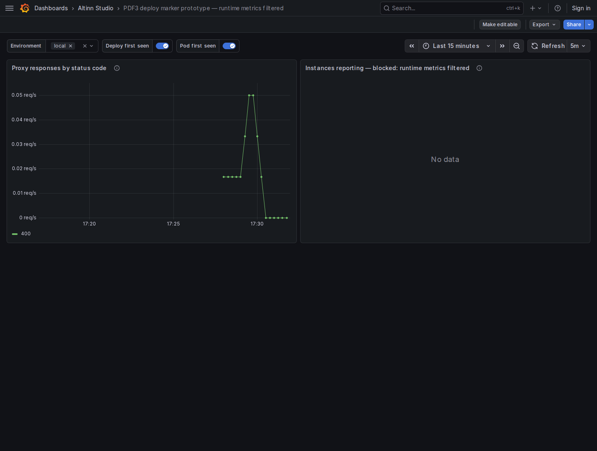

# Studio dashboard telemetry prototype — stopped at alignment PR

Alignment: https://github.com/Altinn/altinn-dashboards-grafana/pull/59 (ready for review).

The deploy/restart/instances proposal does not meet its acceptance criteria on the current pipeline. No annotation PR or Altinn Studio draft PR was created, following step 2(c). No Altinn Studio source or manifests were changed.

## What was run

- Dashboard baseline: upstream `20b4119`; alignment revision `c36471a`.
- Altinn Studio: current `origin/main`, `fae94da719`.
- Worktrees: `/home/agent/code/.worktrees/studio-dashboard-alignment` and `/home/agent/code/.worktrees/studio-telemetry-prototype`. Both primary checkouts were left clean.
- Started the actual devenv kind/Flux/collector/proxy/Victoria stack with `DEVENV_DASHBOARDS_REPOSITORY=/home/agent/code/.worktrees/studio-dashboard-alignment make start-minimal-monitoring` in the pdf3 directory. Startup completed in 5m6s. Grafana is 12.4.8; its metrics datasource keeps UID `altinn-studio-metrics` and `timeInterval: 15s`.
- Built pdf3's real proxy twice, with `CGO_ENABLED=0 go build -ldflags '-X altinn.studio/pdf3/internal/telemetry.serviceVersion=prototype-v1' -o <artifact>/proxy-v1/main ./cmd/proxy`, then `prototype-v2`. Packed each binary in a scratch image and pushed to the fixture registry as `localhost:5001/pdf3-proxy:prototype-v1` / `prototype-v2`.
- Applied each image using `kubectl -n runtime-pdf3 set image deployment/pdf3-proxy pdf3-proxy=<image>` and waited for `rollout status`. Generated controlled HTTP 400 requests with `curl -X POST -H 'Host: pdf3-proxy.runtime-pdf3.svc.cluster.local' -H 'Content-Type: application/json' --data '{}' http://localhost:8020/pdf` (and service port-forwards).
- Ran `kubectl -n runtime-pdf3 rollout restart deployment/pdf3-proxy`, waited for completion and generated another request. The image and `service.version=prototype-v2` stayed fixed; both pod UIDs changed. VictoriaMetrics' HTTP metrics show v1, v2, and a new pod with the same v2 after restart. These are real service exports, not injected service metrics.
- Queried VictoriaMetrics through the same observability-proxy read path and token as Grafana. Saved raw results in `live-after-restart.json` and `live-metric-names.json`.

## Blocker 1: runtime metrics are dropped

The deployed collector's `filter/metrics_allowlist` includes only `^(altinn|http|signalr\.server)([._].*)?$`. Both runtime and Studio pipeline configurations use it. The local overlays preserve that filter.

pdf3 already starts Go runtime instrumentation, and the installed Go runtime SDK v0.69.0 defines `go.memory.used` (also `go.goroutine.count` and other runtime metrics). These are independent of requests. Neither `go.memory.used` nor any `go.*` / `runtime.go.*` series appears in VictoriaMetrics; only the service's HTTP metrics arrive. Therefore there is no verified always-exported Go metric name **as stored in VictoriaMetrics** to build this feature on.

Designer targets .NET 10 and calls `AddRuntimeInstrumentation()` (package 1.19.0), which subscribes to the built-in `System.Runtime` metrics on .NET 9+. `dotnet.process.memory.working_set` is the documented candidate. It also fails the current allowlist. Designer was not started; its exact stored metric name/labels and end-to-end behavior remain unverified. Source references: [runtime package](https://github.com/open-telemetry/opentelemetry-dotnet-contrib/blob/Instrumentation.Runtime-1.19.0/src/OpenTelemetry.Instrumentation.Runtime/README.md#metrics), [.NET built-in metrics](https://learn.microsoft.com/en-us/dotnet/core/diagnostics/built-in-metrics-runtime).

The live instance query below returns an empty vector, not a live-instance count. Treating this as zero would hide pipeline data loss.

```metricsql
count by ("deployment.environment.name") (
  group by ("deployment.environment.name", "k8s.pod.uid") (
    present_over_time({"go.memory.used", "service.name"="pdf3-proxy",
      "deployment.environment.name"=~"$env"}[1m])
  )
)
```

A prerequisite would be an explicit telemetry policy change allowing a narrowly chosen runtime metric for each SDK. No filter bypass was used to claim service-level success.

## Blocker 2: the proposed range-window first-seen query makes false deploy dots

A separate, clearly synthetic `prototype_heartbeat{env="local",version="old|new"}` fixture was imported into the **same real VictoriaMetrics instance**, using `/api/v1/import/prometheus`, to isolate MetricsQL semantics from the missing service metrics. Samples are 15 seconds apart. It is not presented as service deployment evidence.

At evaluation time `1792078054`, the dashboard range begins at `1792077931` (123 seconds earlier):

- old starts at `1792077754`, 177 seconds **before** range start;
- new starts at `1792077994`, 63 seconds **after** range start.

Evaluated via `/api/v1/query` with `time=1792078054`, `step=15s`, `nocache=1`:

```metricsql
tfirst_over_time(max by (env,version) (prototype_heartbeat)[123s]) > 1792077931
```

It returns **both versions**: old at `1792077945` and new at `1792078005`. The old version incorrectly becomes an annotation inside the range. The aggregation inside the rollup is a subquery and also shifts timestamps onto its evaluation grid.

Rolling up raw samples first preserves timestamps but still produces a false old-version event:

```metricsql
min by (env,version)(tfirst_over_time(prototype_heartbeat[123s])) > 1792077931
```

It returns old at `1792077934` and new at `1792077994`: the first **sample within the window** is not the first time the version ever appeared. This matches [tfirst_over_time's documented lookbehind-window semantics](https://docs.victoriametrics.com/metricsql/#tfirst_over_time).

An extended lookbehind demonstrates the missing context in this fixture:

```metricsql
min by (env,version)(tfirst_over_time(prototype_heartbeat[423s])) > 1792077931
```

It returns only new, at the exact raw timestamp `1792077994`. This is an experiment, **not a production-approved final query**: additional history, gaps, retention and reappearing versions require a defined policy and further verification. No version already running at range start should be inferred as newly deployed solely from its first in-range sample.

## Annotation options and candidate queries

Checked the exact [Grafana 12.4.8 annotation implementation](https://github.com/grafana/grafana/blob/v12.4.8/packages/grafana-prometheus/src/annotations.ts) and [editor](https://github.com/grafana/grafana/blob/v12.4.8/packages/grafana-prometheus/src/components/AnnotationQueryEditor.tsx), rather than assuming the latest Grafana docs match this release:

- `useValueForTime: true` is supported. Values must be **milliseconds**, so a `tfirst_over_time` result (seconds) must be multiplied by 1000.
- `titleFormat` and `textFormat` expand `{{label}}`; `tagKeys` selects comma-separated label keys. Dotted labels can be named directly, e.g. `{{service.version}}` and `deployment.environment.name`.
- The implementation groups nearby/identical event times within each returned series. Pre-aggregation/grouping and selecting raw first-seen times still matter.

The local-only prototype uses these **unshipped, rejected/unverified** candidates (M below is the raw selector `{"go.memory.used", "service.name"="pdf3-proxy", "deployment.environment.name"=~"$env"}`):

```metricsql
# Deploy: rejected by the range-start fixture, and M is absent on the live pipeline.
(tfirst_over_time(max by ("deployment.environment.name", "service.version") (M)[$__range])
  > ${__from:date:seconds}) * 1000

# Pod first seen: also needs prior-range context and an admitted runtime metric.
(min by ("deployment.environment.name", "k8s.pod.uid") (tfirst_over_time(M[$__range]))
  > ${__from:date:seconds}) * 1000
```

pdf3 provides `k8s.pod.uid`; there is no verified `service.instance.id` for this Go service. A replaced pod can be distinguished, but detecting a container-process restart inside the same pod would need a process identity/start-time signal and is unverified.

## Screenshot evidence and remaining limits



The screenshot shows the real "Proxy responses by status code" panel with the two candidate annotations enabled and no marker data, alongside the runtime-based "Instances reporting" panel returning No data. It records the failure, not successful annotations. Captured with `playwright-cli -s=studio-dashboards open --browser chromium`, then `goto`, `resize 1456 1100`, and `screenshot`.

All three aligned dashboards were render-checked. The local fixture intentionally excludes observability self-scraping, so annotations for scraped observability components were not verified. Existing real `up` queries are unchanged. No Flux event or deploy-pipeline hook was introduced.

No end-to-end working deploy/restart/instances query is approved by this experiment. Follow-up questions are which SDK metrics to admit, which identity should represent a process restart, and what history/gap/retention policy defines "first seen". The experiment used the real `local` environment, not production.

## Alignment verification and CI

The alignment validator, public-generation check, strict dashboard-linter 0.1.1, all CI-equivalent kustomize 5.4.3 / kubeconform 0.6.7 builds, relaxed yamllint, 12 negative mutation cases, UID/panel/target comparisons, and `git diff --check` pass. Actual GitHub validation jobs also pass. The separate kustomize diff **comment-posting** job fails with HTTP 403, `Resource not accessible by integration`, on this fork PR; both of its build jobs pass.

The upstream feature push and GitHub attachment upload were denied. The feature branch was pushed to the existing fork; immutable screenshot URLs on a separate fork evidence branch are embedded in the upstream PR. No primary checkout was edited, no main branch was pushed and nothing was merged.
